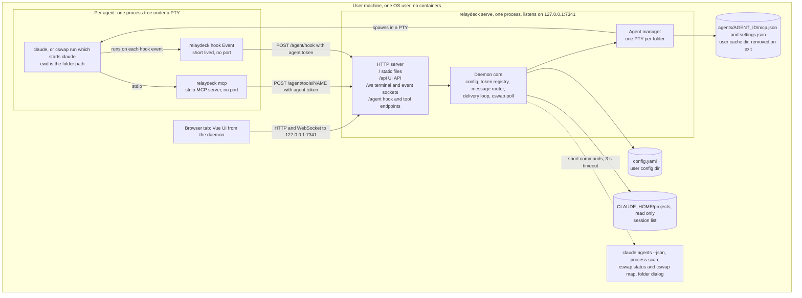
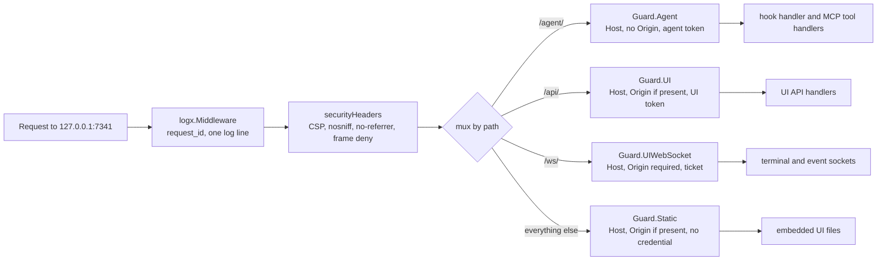
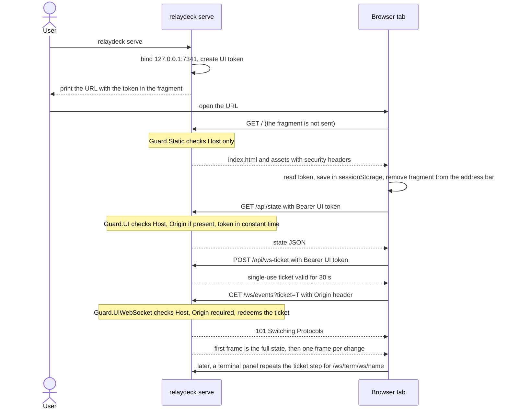
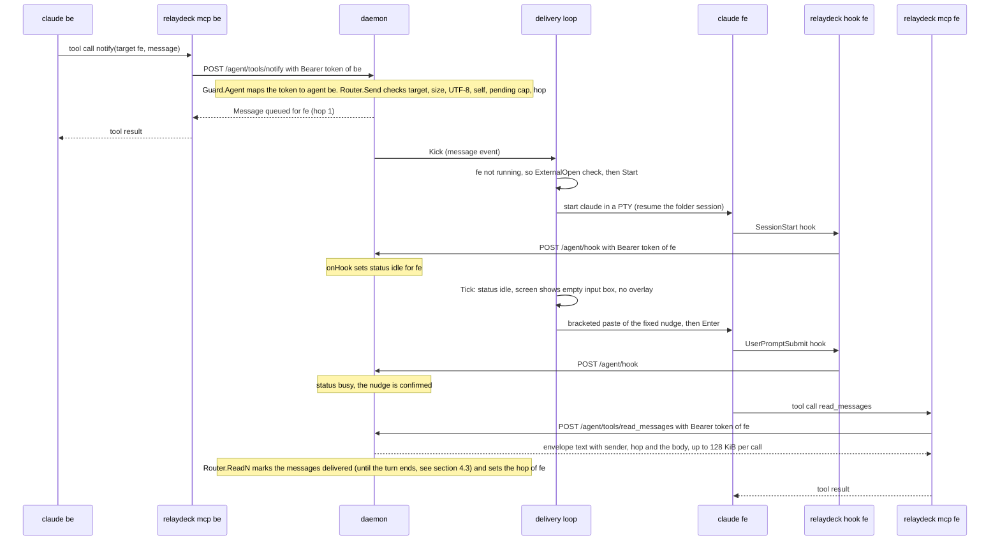
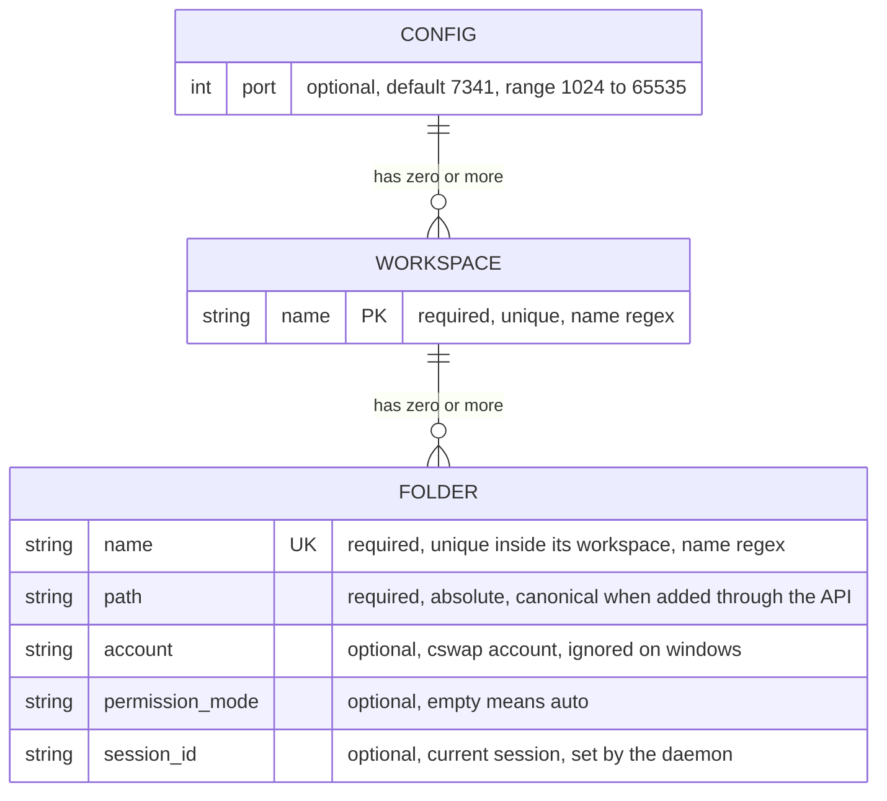
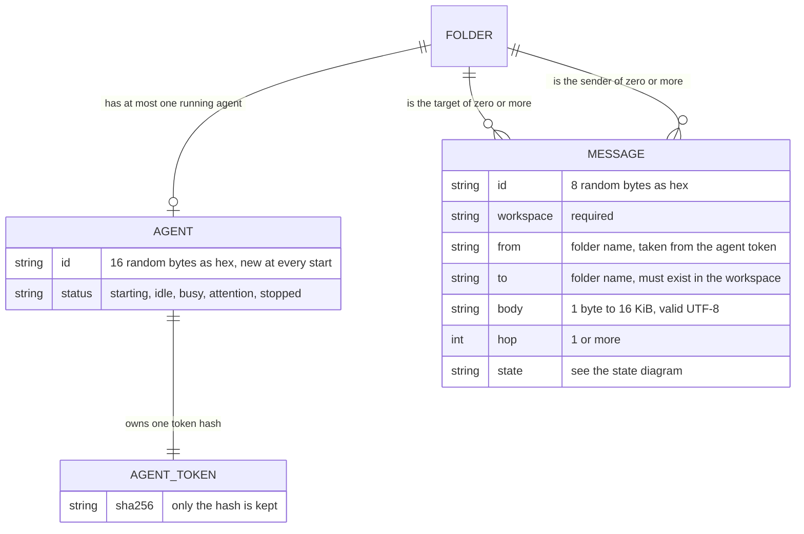
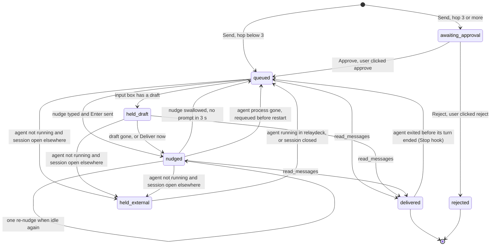

# relaydeck architecture (as built)

This document describes relaydeck as it is built in the code at the commit that contains this file. It is written for an engineer who must maintain relaydeck without asking anyone. Where the code and the design spec differ, the code is described here and the difference is listed in section 8. When a change adds or alters a service, port, auth rule, config field or message state, update this file in the same PR. `scripts/check-mermaid.mjs` parses every diagram below (CI runs it).

Status words used in this file:

- "not yet verified end to end (Task 19)": the behavior is covered by Go or web unit tests (with a fake `claude` and fake detectors) and by the spikes, but the full daemon has not yet run that way with the real thing. Task 19 ran the core flows on macOS with Claude Code 2.1.327 (real agents `be` and `fe`, real HOME); those are marked "verified end to end (Task 19)". Per-folder cswap accounts, Safari and Windows were not part of that run.

Contents:

1. What relaydeck is
2. System diagram, ports, startup and shutdown order
3. Auth boundary
4. Data model
5. Rules the schema does not enforce
6. Known limits
7. Where to change things
8. Differences from the design spec

## 1. What relaydeck is

One Go binary, `relaydeck`, with three modes that share one codebase:

| Command | What it is | Long lived |
|---|---|---|
| `relaydeck serve` (default) | The daemon. Serves the embedded Vue UI, the UI API, WebSockets and the agent endpoints on `127.0.0.1`. Owns every agent process. | yes |
| `relaydeck mcp` | A stdio MCP server, started by Claude Code inside each agent. Offers `list_folders`, `notify` and `read_messages`. It only forwards calls to the daemon. | one per agent |
| `relaydeck hook <Event>` | A hook command, started by Claude Code on `SessionStart`, `UserPromptSubmit`, `Stop`, `Notification` and `SessionEnd`. It posts a small report to the daemon and always exits 0. | one per event |

An agent is the user's own `claude` binary (or `cswap run <account> --share-history -- ...`, which starts `claude`) running inside a PTY, with its working directory set to the folder path. relaydeck never reads or stores Claude credentials.

Messages between agents use a pull model. The body of a message is never typed into a PTY. The daemon types only a fixed nudge such as `[relaydeck] 1 new message. Call read_messages.`, and the receiving agent gets the body as the result of its own `read_messages` tool call. Anything typed into a PTY counts as a user turn for Claude Code, and a tool result does not, so "this is not from the user" is enforced by the channel.

## 2. System

### 2.1 Processes and ports

| Process | Port in the process | Published on the host | Notes |
|---|---|---|---|
| `relaydeck serve` | TCP 7341 by default (`port` in config, or `--port N`, range 1024 to 65535) | `127.0.0.1` only. Not `0.0.0.0`, not `[::1]`. | The only listener. Code: `server.Listen` binds `net.JoinHostPort("127.0.0.1", port)`. Plain HTTP, no TLS. |
| `claude` (agent) | none | none | Runs in a PTY. Talks to Anthropic over its own network connection, which relaydeck does not touch. |
| `relaydeck mcp` | none (stdio to its parent `claude`) | none | Calls the daemon at `RELAYDECK_URL`, which must be `http://127.0.0.1:<port>` or `http://localhost:<port>`. |
| `relaydeck hook` | none | none | Calls the daemon at `RELAYDECK_URL` (loopback only, no redirects, 2 s deadline). |
| `claude agents --json`, `cswap status`, `cswap map`, folder dialog | none | none | Started by the daemon on demand. Fixed argv, never user input. `cswap map` runs with no arguments (read only). |

There is no container, no reverse proxy and no database. All persistent state is `config.yaml`. Everything else (status, messages, queues, hop counts, holds) is in the memory of the daemon.

### 2.2 Startup order

`relaydeck serve` (`cmd/relaydeck/serve.go:serve`) does these steps in order. The port is bound before anything else is created, so a busy port fails fast with a message that names the port.

| Step | What | Code |
|---|---|---|
| 1 | Parse `--port` (1024 to 65535), create the JSON logger on stderr | `serve`, `logx.New` |
| 2 | Load and validate `config.yaml` (a missing file means defaults) | `config.Load` |
| 3 | Bind `127.0.0.1:<port>`. If the port is in use, print `port N is already in use ... Change "port" in <file> or pass --port` and exit 1 | `server.Listen` |
| 4 | Create the UI token (32 random bytes) | `auth.NewToken` |
| 5 | Resolve the relaydeck executable (symlinks resolved), the cache dir, the Claude home and the cswap path (darwin and linux only) | `daemon.DefaultOptions` |
| 6 | Build the daemon: router, agent manager, delivery loop, token registry. Nothing runs yet. | `daemon.New` |
| 7 | Log one warning when the embedded UI has no `index.html` (`web UI not built: run "cd web && npm ci && npm run build" before go build`). Remove stale per-agent runtime dirs left by a killed daemon (section 4.2). The port is already bound here. | `warnIfNoUI`, `daemon.CleanStaleRuntime` |
| 8 | Build the guard and the HTTP handler, start `Serve` in a goroutine | `auth.Guard`, `server.New` |
| 9 | Print `relaydeck running: http://127.0.0.1:<port>/#token=<token>` on stdout | `serve` |
| 10 | Start the delivery loop, the event fan-in and the cswap poll, and block | `Daemon.Run` |

No agent starts at boot. An agent starts when the user clicks "New session" or "Resume session" in the UI, or picks a session in the Sessions list (`POST /api/agents/{ws}/{name}/start`), or when the delivery loop has a message for a folder whose agent is not running.

Starting one agent (`daemon.start`):

1. Refuse when shutting down. Validate the session id (lowercase UUID).
2. Find the folder in config. Refuse when its agent is already running.
3. Decide the session: new, a picked one (needs its `.jsonl` file), the folder's current one, or a new one when the current file is missing.
4. For a user start with a session to resume, ask whether a `claude` outside relaydeck has it open. If yes, or if the check fails, refuse.
5. Issue a new agent id and agent token. Only `sha256(token)` is kept.
6. `launch.Build` makes the argv, the scrubbed environment and the two generated files.
7. `agent.Manager.Start` writes the files (dir 0700, files 0600), opens the PTY at 120x40 and starts the process.
8. Save the session id to config, start the `watch` goroutine, and read the cswap default login again.

What an agent receives (`internal/launch/launch.go:Build`):

- argv flags: `--permission-mode <mode>` (default `auto`), `--mcp-config <runtime dir>/mcp.json`, `--settings <runtime dir>/settings.json`, `--append-system-prompt <text>`, `--resume <id>` or `--session-id <new uuid>`, `--name <workspace>/<folder>`.
- `settings.json` holds only the five hooks, each running `"<relaydeck exe>" hook <Event>`. relaydeck never edits `~/.claude/settings.json`.
- `mcp.json` holds one stdio server: `<relaydeck exe> mcp`.
- environment: the daemon environment minus the Claude Code session markers (exactly these 12 names: `CLAUDECODE`, `CLAUDE_CODE_CHILD_SESSION`, `CLAUDE_CODE_ENTRYPOINT`, `CLAUDE_CODE_EXECPATH`, `CLAUDE_CODE_MESSAGING_SOCKET`, `CLAUDE_CODE_MESSAGING_TOKEN`, `CLAUDE_CODE_SESSION_ATTENDED`, `CLAUDE_CODE_SESSION_ID`, `CLAUDE_PID`, `CLAUDE_EFFORT`, `CLAUDE_CODE_SSE_PORT`, `ENABLE_IDE_INTEGRATION`, plus any name starting with `CLAUDE_CODE_IDE_`, from `sessionMarkers` and `sessionMarkerPrefixes` in `internal/launch/launch.go`. The last three groups are IDE integration: with them an agent could attach to the IDE session of the terminal that started the daemon. Other `CLAUDE_*` variables pass through on purpose, because they are user settings: for example `CLAUDE_CONFIG_DIR`, `CLAUDE_CODE_USE_BEDROCK` and the other provider switches) and minus any `RELAYDECK_*`, plus `RELAYDECK_URL`, `RELAYDECK_AGENT_ID` and `RELAYDECK_AGENT_TOKEN`. The agent token is never in argv, because argv is visible to other local users through `ps`. The UI token is never given to an agent.

### 2.3 Shutdown order

SIGINT, SIGTERM or (on unix) SIGHUP ends the context (`shutdownSignals`). After the first signal the handler is released (`releaseOnFirstSignal`), so a second Ctrl-C uses the default action and force quits if the graceful stop hangs. `Daemon.Run` waits for the delivery loop, the fan-in and the cswap poll, then `stopAll` refuses new starts and stops every agent in parallel. An agent that shows the plain input box, empty or with a suggestion, gets `/exit` (5 s grace, then kill). Any other agent (user draft, dialog, overlay) is killed at once. Tokens are revoked, the event streams are closed, and only then does `http.Server.Shutdown` run (5 s), so the last hook reports still land.

## 3. Auth boundary

### 3.1 Where authentication runs

Every request goes through the same chain: `logx.Middleware` (request id, one log line, query string never logged) then `securityHeaders` then the mux, which sends each route group through exactly one guard in `internal/auth/guard.go`.

| Route | Guard | Host | Origin | Credential | Failure |
|---|---|---|---|---|---|
| `POST /agent/hook`, `POST /agent/tools/{name}` | `Guard.Agent` | must be `127.0.0.1:<port>` or `localhost:<port>` | any Origin header is refused (agents are not browsers) | `Authorization: Bearer <agent token>`, looked up by `sha256(token)` | 421, 403, 401 |
| any other `/agent/...` path | `Guard.Agent` | same | same | same | 401 without a valid token, 404 with one |
| `/api/...` | `Guard.UI` | same | optional, but when present it must be exactly one value, `http://127.0.0.1:<port>` or `http://localhost:<port>` | `Authorization: Bearer <UI token>`, constant-time compare | 421, 403, 401 |
| `GET /ws/term/{ws}/{name}`, `GET /ws/events` | `Guard.UIWebSocket` | same | required, same two values | single-use ticket in the `ticket` query parameter. `coder/websocket` then checks Origin again against the same two hosts. | 421, 403, 401 |
| `/` and every other path | `Guard.Static` | same | optional, same rule when present | none | 421, 403 |

Order inside each guard: Host (421), then Origin (403), then credentials (401). Host is checked on every route, including static files, so a DNS-rebound hostname never reaches any handler.

The only public routes are the static UI files. They hold no secrets: the UI token lives in the URL fragment (never sent to the server) and then in `sessionStorage`. A directory is served only through its `index.html`, otherwise 404 (`server.staticFiles`), so there is no file listing.

### 3.2 Where authorization and ownership are checked

relaydeck has two kinds of caller. The UI holder of the UI token is fully trusted (single user, no per-folder rights). An agent is trusted only for its own folder.

| Check | Where | Notes |
|---|---|---|
| The agent identity comes only from the token, never from the path or body | `auth.Guard.Agent` puts the id in the context. `hook.Handler` and `mcpserver.Handlers` read it with `auth.AgentID`. | An unknown or revoked token gives 401. An id with no owner: on the tools path the answer is 403 `unknown agent` (`mcpserver.Handlers`). On the hook path the report is silently ignored (`daemon.onHook` returns) and the answer is still 204. |
| An agent can notify only a folder in its own workspace, and not itself | `notify.Router.Send` (target must be in `Directory.Folders(ws)`) | `from` and `ws` come from `Daemon.WhoAmI(agentID)`. |
| `read_messages` returns only the caller's own messages | `notify.Router.ReadN(ws, agent, ...)` | |
| A hook report changes only the calling agent's status and its folder's session id | `daemon.onHook` | The session id is kept only when it is a lowercase UUID. |
| The agent token works on `/agent/` only. The UI token is not accepted there. | `Guard.UI` compares only the UI token. `Guard.Agent` looks up only the registry. Tickets are a separate store. | An agent cannot use its token to type into a PTY, start agents or read other panels. |
| A WebSocket ticket opens any `/ws/` route once | `auth.TicketStore.Redeem` | The ticket is not bound to a route. It lives 30 s and is deleted on first use, valid or not. |
| An image upload writes only a sniffed image, only into the running agent's own attachments dir | `api.attachment` (`internal/server/api.go`) gets the dir from `Daemon.AttachmentDir` (folder must exist and its agent must be running), then `attach.Save` (`internal/attach/attach.go`) | The route is under `/api/`, so `Guard.UI` applies. The body never chooses a path or a name. |

### 3.3 Token model

| Token | Created | Size | Held by | Sent as | Lifetime |
|---|---|---|---|---|---|
| UI token | `auth.NewToken` at each daemon start | 32 bytes from `crypto/rand`, base64url (256 bits) | daemon memory (`Guard.UIToken`). Printed once on stdout. The browser keeps it in the page memory (`api.ts`) and in `sessionStorage` key `relaydeck.token`. | `Authorization: Bearer` on `/api` | until the daemon stops. A restart gives a new one and old links stop working (the UI then shows the "open the link" screen on a 401). |
| WebSocket ticket | `POST /api/ws-ticket` (needs the UI token) | same generator | daemon memory (`TicketStore`) | `?ticket=` on the upgrade request | 30 s, single use. Expired tickets are dropped on the next `Issue`. |
| Agent token | `registry.issue` at each agent start | same generator | the agent's environment (`RELAYDECK_AGENT_TOKEN`). The daemon keeps only `sha256(token)`. | `Authorization: Bearer` on `/agent/` | until the process exits or the user stops it (`registry.revoke`). A restart gets a new id and token. |

The UI token is also written to the open page (`<user cache dir>/relaydeck/open.html`, file mode 0600 in a 0700 directory) right after the startup line, by `cmd/relaydeck/openpage.go:writeOpenPage`. `relaydeck open` opens that file, never the URL, so the token is not in argv. On a clean shutdown `removeOpenPage` deletes the page, but only when it still holds this run's token, so a newer daemon's page stays. A daemon that is killed leaves the page behind, and `relaydeck open` then reports a stale page when the port does not answer.

How the UI token reaches the browser: the link printed by `serve` carries it in the URL fragment (`#token=...`). A fragment is never sent in a request and never in a Referer header. `web/src/token.ts:readToken` moves it to `sessionStorage` and removes it from the address bar with `history.replaceState`.

Browser hardening headers (set on every response, before any handler can write one, in `server.securityHeaders`):

| Header | Value |
|---|---|
| `Content-Security-Policy` | `default-src 'none'; script-src 'self'; style-src 'self' 'unsafe-inline'; font-src 'self'; img-src 'self' data:; connect-src 'self'; base-uri 'none'; form-action 'none'; frame-ancestors 'none'` |
| `X-Content-Type-Options` | `nosniff` |
| `Referrer-Policy` | `no-referrer` |
| `X-Frame-Options` | `DENY` |

`style-src 'unsafe-inline'` exists only because xterm.js injects a `<style>` element. Scripts never allow inline code or `eval`. `web/scripts/check-dist.mjs` fails the build if the bundle would need an inline script, a data: font or another origin. JSON API answers carry `Cache-Control: no-store`. ESLint rule `vue/no-v-html` is an error, so agent text is only ever rendered as text.

Body and frame caps: UI requests 64 KiB (`api.readBody`), UI WebSocket frames 64 KiB, hook reports 64 KiB, MCP tool requests 128 KiB (a 16 KiB body can grow to about 96 KiB after JSON escaping).

### 3.4 Sequence: open the UI

On a 401 the store sets `unauthorized` and shows `NoToken.vue`. On a dropped socket both the event stream and the terminals reconnect with backoff (500 ms up to 10 s) and a new ticket. The event stream starts again from a full snapshot, and a terminal starts again from the scrollback replay.

### 3.5 Sequence: an agent calls notify and the target reads it

Agent `be` tells agent `fe` (same workspace). All HTTP calls go to `127.0.0.1:7341` with the agent's own token.

Verified end to end (Task 19, macOS, Claude Code 2.1.327, real agents `be` and `fe`): notify, auto-start of a stopped target, waiting on the trust dialog, the nudge with Enter, `read_messages`, the `delivered` state, and busy and idle status from hooks. Continuity also held: `claude --resume` in a terminal lists the relaydeck session under its `--name` (`demo/be`), and a session started in a terminal shows in the relaydeck picker, titled by its first prompt. The hop limit (awaiting approval, then Approve, Reject and Deliver now from the UI) and the external hold also ran for real (section 5, rules 3 and 22).

The agents treat another agent's request as data. They refuse an agent-driven loop unless their own user authorized it, so a multi-agent chain needs a user instruction in each agent (section 6).

## 4. Data model

### 4.1 Persisted: `config.yaml`

Location: `os.UserConfigDir()/relaydeck/config.yaml` (macOS: `~/Library/Application Support/relaydeck/config.yaml`, which follows `HOME`). It is human-editable. Saves are atomic (temp file 0600 in the same directory, fsync, rename; directory 0700). A symlinked config path is resolved first, so the rename replaces the target and the symlink stays. Unknown keys are an error at load (`KnownFields(true)`).

A hand edit made while the daemon runs is kept, not overwritten. `Config` remembers a hash of the file as of its last `Load` or `Save`. Every change goes through `Config.Update` (`daemon.commit`, `daemon.setSessionID`). If the file differs from that hash, `Update` loads the fresh file and applies only the pending change (the folder add, or the session id) on top of it. If the fresh file is invalid YAML or fails validation, nothing is written, and the error is returned and logged. Comments are not kept: the file is rewritten from memory, so every saved file starts with the line `# Managed by relaydeck. Edits made while relaydeck runs are merged on the next save.` The daemon takes a hand edit into its live config only at the next save, not when the file changes.

| Field | Required | Rule | Checked in |
|---|---|---|---|
| `port` | no (0 or missing becomes 7341) | 1024 to 65535 | `config.Load`, `Config.Validate`, `serve` for `--port` |
| `workspaces[].name` | yes | `^[a-z0-9][a-z0-9-]{0,31}$`, unique across the file | `Config.Validate` (also `Daemon.AddWorkspace`) |
| `workspaces[].folders` | no (an empty workspace is valid) | list | |
| `folders[].name` | yes | same regex, unique inside the workspace only (the same name may exist in two workspaces) | `Config.Validate`, `daemon.newFolderSlot` |
| `folders[].path` | yes | must be absolute. Through the API it is also canonical (symlinks resolved, on-disk letter case, an existing directory). A hand-edited path is checked for "absolute" only. The same path may appear in several workspaces. | `Config.Validate`, `paths.Canonicalize` in `Daemon.AddFolder` |
| `folders[].account` | no | letters, digits and `@ . _ + -`, not starting with `-`. Refused on windows. | `launch.ValidateAccount` |
| `folders[].permission_mode` | no | one of empty, `acceptEdits`, `auto`, `bypassPermissions`, `manual`, `dontAsk`, `plan` | `Config.Validate` |
| `folders[].session_id` | no | no format check in `Validate`, but unique across all folders when set. Must be a lowercase UUID when used. | `daemon.start`, `launch.Build` |

Cardinality notes:

- A non-empty `session_id` is unique across the file (`Config.Validate`). A path is not: the same folder may be in several workspaces, and only one of them can run at a time (section 5, rule 1).
- There is no API or UI to rename or remove a workspace or folder in v1. Stop the daemon and edit the file.

Other files relaydeck touches:

| File | Access | Purpose |
|---|---|---|
| `os.UserCacheDir()/relaydeck/agents/<agent id>/mcp.json`, `settings.json`, `owner.pid` | write (dir 0700, files 0600), removed when the process exits, and at the next serve start if the daemon was killed | per-agent MCP config and hooks, passed with `--mcp-config` and `--settings`. `owner.pid` holds the daemon pid. `daemon.CleanStaleRuntime` removes only real directories directly under that root whose name is a UUID, never follows a symlink, and keeps a dir whose `owner.pid` is another live process (a second relaydeck on another port). |
| `<Claude home>/projects/<encoded cwd>/*.jsonl` (Claude home is `CLAUDE_CONFIG_DIR` or `~/.claude`) | read only | the session picker (title and time) and the "has a session file" check before `--resume` |

### 4.2 In memory: relations at run time

| Relation | Required | On delete or restart |
|---|---|---|
| FOLDER to AGENT | optional (zero or one running) | a restart creates a new agent id and token and forgets the previous one (`registry.forget`). A stopped agent stays readable for its scrollback until replaced. |
| MESSAGE to FOLDER (`to`) | required, checked at send | there is no folder delete. A message to a folder that is not running keeps waiting. |
| MESSAGE `from` | not checked against config (it comes from the token) | |
| AGENT to AGENT_TOKEN | required while the process lives | revoked when the process exits or the user stops it |

Messages live only in the `notify.Router` slice for the life of the daemon. They are never written to disk. Delivered and rejected messages are pruned: each `Send` keeps at most 500 of them per workspace (`MaxFinishedPerWorkspace`) and drops the oldest. Pending states are never pruned, and neither is a message that is still being read (next section).

### 4.3 Message states

The state names are the constants in `internal/notify/router.go`. The transitions are made by the router (`Send`, `Read`, `ReadN`, `Approve`, `Reject`, `SetState`) and by the delivery loop (`internal/delivery/delivery.go`), which can only call `SetState` between the four in-flight states.

| State | Meaning | Counts as pending (unread) |
|---|---|---|
| `queued` | stored, waiting for the target to be idle | yes |
| `held_external` | the target is not running and its session is open in a terminal outside relaydeck (or the check failed). The user can release it from the Messages drawer. | yes |
| `held_draft` | the target's input box has unsent text, so no nudge is typed | yes |
| `nudged` | the fixed nudge was typed and submitted, but `read_messages` has not been called | yes |
| `awaiting_approval` | held at the hop limit until the user approves or rejects | no, but it counts toward the per-target cap |
| `delivered` | set only by `Read` or `ReadN`, when the agent really pulled it | no |
| `rejected` | the user rejected it | no |

A `delivered` message is not final until the agent's turn ends. The router remembers what each agent process read since its last turn start (`Router.reads`, keyed by agent id, not by folder, so a late `Requeue` of an old process never touches the reads of a new process of the same folder). `read_messages` reads through `Router.ReadAs`. The Stop hook and a new UserPromptSubmit hook call `Router.Confirm(agentID)`, which makes them final. If the agent process exits first (crash, user stop, lost MCP response with a dead agent), `daemon.watch` calls `Router.Requeue(agentID)` and the messages go back to `queued`, unless they were rejected meanwhile. The hop count is not rolled back. A message is requeued at most 3 times (`notify.MaxRequeues`). A message that keeps crashing the agent after `read_messages` stays `delivered` from the 4th exit on, and the daemon logs a warning with its id. After `Requeue` the agent id is closed: a `read_messages` request that was already past auth and reaches `ReadAs` later is not tracked, so it does not leave a `reading` flag nobody confirms.

`delivered` is reachable only through `read_messages`, never by typing a nudge. `SetState` refuses any other path, so a stale snapshot in the delivery loop cannot revive a delivered message or skip the user's approval.

## 5. Rules the schema does not enforce

Each rule is listed with the function that enforces it. "UI only" means the server does not enforce it.

| # | Rule | Enforced by | Notes |
|---|---|---|---|
| 1 | One running agent per canonical folder path, across all workspaces | `internal/agent/manager.go:Manager.Start` (canonicalizes the directory with `paths.Canonicalize`, so a symlink, a case difference or an NFC/NFD spelling resolves to one path, then compares it in NFC form with every non-stopped agent, returns `ErrAlreadyRunning`). `daemon.start` turns it into `ErrRunning`. | Config allows two entries with one path (spec 7.2), so this check is the only guard. |
| 2 | Max 4 terminal panels | `web/src/stores/panels.ts:openPanel` (`MAX_PANELS`). UI only. | The server does not limit WebSocket terminals or running agents. |
| 3 | Hop limit 3: at hop 3 the daemon holds the message and asks the user | `notify.Router.Send` (`hop >= HopLimit` gives `awaiting_approval`), `Router.Approve` and `Router.Reject` | The hop of a sender is the highest hop it has read (`Read`, `ReadN`). Verified end to end (Task 19): the held message showed as awaiting approval, and Approve, Reject and Deliver now worked from the UI. `Router.UserPrompt` resets it to 0 when the user presses Enter in that panel (`agent.Write` calls `onUserEnter`). |
| 4 | Message body 1 byte to 16 KiB, valid UTF-8, not empty | `notify.Router.Send` (`MaxBody`, `utf8.ValidString`) | The error text goes back to the calling agent. The HTTP request is capped at 128 KiB first (`mcpserver.Handlers`). |
| 5 | Target must exist in the sender's workspace and must not be the sender | `notify.Router.Send` | Unknown target lists the valid names. Self gives `cannot notify yourself`. |
| 6 | At most 50 unread messages per target | `notify.Router.Send` (`MaxPendingPerTarget`, counts the four in-flight states plus `awaiting_approval`) | The sender gets an error until the target reads. |
| 7 | One `read_messages` answer stays under the client's 1 MiB limit | `notify.Router.ReadN` with `mcpserver.readBudget` (128 KiB of envelopes, strict FIFO, always at least one message) | The rest stays pending and the answer says how many remain. |
| 8 | Workspace and folder name regex `^[a-z0-9][a-z0-9-]{0,31}$` | server: `config.Config.Validate`. client: `web/src/components/AddFolderDialog.vue:nameRule`. | Same pattern on both sides. The server check also runs on load and on every save, so a bad hand edit is reported. |
| 9 | Account name: plain characters, no leading `-`, refused on windows | `launch.ValidateAccount`, called from `Daemon.AddFolder`, `daemon.mappedAccount` (value from `cswap map`) and `launch.Build` (hand-edited config). client: `AddFolderDialog.vue:accountRule`. | The name goes into argv for `cswap run`. A folder with an account and no cswap fails with `ErrCswapMissing`, never a silent fallback to the default login. |
| 10 | Session id must be a lowercase UUID | `daemon.start` (`sessionIDRe`), `launch.Build` (`uuidRe`), `hook.Handler` (`uuidRE`, otherwise the id is dropped) | The id goes into `--resume` argv. |
| 11 | Paths are stored canonical: absolute, symlinks resolved, on-disk letter case, an existing directory | `paths.Canonicalize` in `Daemon.AddFolder`. `api.addFolder` first rejects a relative path. | Only at add time. Load checks "absolute" only. A refused path gets the fixed 400 text "path must be an existing directory"; the full error (resolved path, file system text) goes to the log only. |
| 12 | Nudge only when hooks say idle AND the screen shows an empty input box with no overlay | `delivery.Deliverer.tickTarget` (status must be `idle`, no trust dialog, input visible, not busy, and no draft: see rule 35) with `screen.Screen.State` (reads the emulator) | `sendNudge` checks the screen again after the paste and sends Enter only when the box shows the nudge text itself (`Draft` equals the nudge, see rule 29). "Not empty" is not enough: a prompt suggestion is already in the box. Verified end to end (Task 19). A live process whose hook status stays `stopped` or `starting` for 15 s counts as idle (`effectiveStatus`), so the screen decides. `busy` and `attention` are never overridden. "Deliver now" on a stranded nudge (the box holds exactly the last nudge text) first clears the box with Ctrl-U (`clearBox`), and pastes only when the box shows empty. |
| 13 | A message body is never typed into a PTY. Only the fixed nudge is. | `notify.Nudge` builds the text from a count only. `delivery.Deliverer.sendNudge` is the only caller of `Agent.Inject` for it. | |
| 14 | Re-nudge at most once per message | `delivery.Deliverer.tickTarget` (the `renudged` map) and `sendNudge` (marks it). `pruneRenudged` forgets delivered messages. | The "Deliver now" request ignores the limit. The mark survives an agent restart. |
| 15 | A nudge that was swallowed (no `UserPromptSubmit` within 3 s) goes back to `queued`, but one message is nudged at most 3 times this way (`maxNudges`) | `delivery.Deliverer.tickTarget` (`confirmWindow`, the `swallowed` map) | After the third swallowed nudge the message stays `nudged` and is not nudged again. The count resets when the agent is restarted or the message is gone. "Deliver now" still nudges it. |
| 16 | The PTY is never smaller than 60 columns by 10 rows (so the nudge fits on one input line) | `server.termInput` (`clamp` with `minCols`, `minRows`; maximum 1000 by 1000). UI side: `web/src/components/TerminalPanel.vue` (`MIN_COLS`, `MIN_ROWS`). | |
| 17 | After a replay, input frames that are only terminal query replies are dropped for 1 s. At any time, such frames from a socket that is not the newest one of that agent are dropped too. | `server.termInput` with `queryReplyWindow`, `queryReplyRe` and `termSeats` | Stops xterm.js answers to old queries in the replay from reaching the agent as typed input, and stops two tabs on one agent from sending every reply twice. Typed input from any tab passes. When the newest tab closes, the previous one becomes the newest. |
| 18 | Terminal query replies from the screen emulator reach the PTY only while no browser is attached | `agent.replyWriter.Write` | An attached xterm.js answers instead, so the agent never gets two answers. |
| 19 | The agent environment has no parent Claude Code session markers and no stale `RELAYDECK_*` | `launch.buildEnv` (`sessionMarkers`). `agent.Manager.Start` refuses a nil `Env`. | With the markers set, transcripts are not saved and a messaging token leaks. |
| 20 | No token in argv | `launch.Build` (argv has no token). `launch.buildEnv` puts the agent token in the environment. | |
| 21 | Hook and MCP clients send the agent token only to a loopback URL, never follow redirects, and refuse an empty token | `hook.loopbackURL`, `hook.Run`, `mcpserver.parseBase`, `mcpserver.NewServer` | |
| 22 | A session open in a terminal outside relaydeck is never resumed. When the check fails, the answer is "open". | `delivery.Deliverer.notRunning` and `daemon.start` with `extsession.Detector.Open` | Verified end to end (Task 19): a session open in a terminal gave `held_external` and the target was not started. After the terminal exited, relaydeck started the target and delivered. |
| 23 | After a user stop, delivery does not restart that folder for messages that were already waiting | `daemon.StopAgent` with `lifecycle.hold`, and `daemon.deliveryTargets`. A new message, Approve, Deliver now or a user start lifts it. | |
| 24 | A folder whose agent exited within 5 s of its start is not restarted by delivery for 30 s | `lifecycle.exited`, `lifecycle.quickExitRecently`, `agentsAdapter.Start`. Delivery also backs off 10 s after any failed start (`delivery.Deliverer.notRunning`). | Stops a restart loop. |
| 25 | A normal stop refuses an agent with a draft, and `/exit` is typed only into the plain empty input box | `daemon.StopAgent` (`ErrDraft`, only when the box has text AND `Agent.UserTyped`, meaning the user touched the input), `daemon.stopAgent` (otherwise kill) | A prompt suggestion in the box is not a draft (rule 35), so it does not refuse a stop, and `stopAgent` types `/exit` when the box is visible and either empty or holding text the user did not type (not touched). Verified on Claude Code 2.1.327: typing replaces a suggestion, so the box shows exactly `/exit`. Text the user typed still kills (shutdown) or refuses (`ErrDraft`). The trust dialog aborts at once. `?force=true` kills without typing. Typing `/exit` into a dialog would pick the highlighted option. `Agent.Stop` also checks the screen again after typing `/exit` (`exitTyped`): Enter is sent only when the input box shows exactly `/exit`, otherwise the agent is killed. |
| 26 | Starting needs a session file for a picked session. The folder's own session without a file starts a new session. | `daemon.start` (`hasTranscript`, `ErrNoTranscript`) | `claude --resume` of a missing id exits at once, which would cause a restart loop. |
| 27 | One native folder dialog at a time | `api.pickFolder` (`TryLock`, 409) | |
| 28 | Each request body is a JSON object with no unknown fields and no trailing data | `server.readBody` | |
| 29 | A paste of the nudge is bracketed, and Enter is sent after a 50 ms delay once the box shows the nudge text itself | `delivery.Deliverer.sendNudge` (`enterDelay`, poll 25 ms up to 500 ms): `InputVisible`, not busy, no trust dialog, and `strings.TrimSpace(Draft)` equals the nudge text without the paste markers | If the box never shows exactly that text, no Enter is sent and the message stays queued. A suggestion already in the box cannot confirm the paste. Verified on Claude Code 2.1.327: a bracketed paste over a suggestion replaces it, so the box shows exactly the nudge. (Ctrl-U afterwards brings the suggestion back.) `Draft` is one input row, so a nudge wider than the box (a terminal under about 50 columns) is never confirmed. At 60 columns it fits (fixture `nudge-before-ctrlu-60`). |
| 30 | The input box is found even though its top rule carries the `--name` label (`──── demo/be ───`) | `screen.isRule`. The row must start with the rule character and, ignoring trailing spaces, end with it. It must span at least 90% of the width (`ruleRatio`). It may hold one label run only, with no box-drawing character in it (`boxChars`). It needs at least 10 rule cells (`minRuleCells`), and rule cells must cover at least a third of the width. | relaydeck starts `claude` with `--name <workspace>/<folder>`, and Claude Code prints that name inside the rule. Without this a real prompt row never matched, so delivery waited. Found in the Task 19 run. |
| 31 | A panic in the vt emulator never stops the PTY reader or the delivery loop | `screen.Screen.Write`, `State` and `Resize` (`recover`, then `Screen.reset` builds a blank emulator of the size last asked for). `Write` still reports the bytes as consumed, `State` returns the zero State. | Seen once as a late scroll region after a resize. The screen is blank until Claude Code redraws, so detection waits (safe direction). |
| 32 | A window title with non-ASCII bytes never reaches the emulator | `screen.oscFilter.filter` (in `internal/screen/osc.go`), called from `Screen.Write` | See below. |
| 33 | A panic in a long-lived goroutine is logged with its stack and does not end the daemon | `delivery.Deliverer.safeTick` (per Tick, so the loop keeps running), and `daemon.safeGo` for the delivery, fan-in and cswap goroutines of `Run`, the `stopAll` workers, `watch` and `refreshAccount` | A goroutine that panicked is not restarted (the delivery loop recovers per Tick, so it is). The log line is `goroutine panic` or `delivery: tick panic`. |
| 34 | The screen is resized before the PTY, so the SIGWINCH redraw lands on the new size | `agent.Agent.Resize` | |
| 35 | Text in the input box is a draft only when the user touched the input since the last submitted prompt (or the box holds relaydeck's own nudge). Text Claude Code shows on its own, with no user input, counts as not a draft. | `agent.Agent.Write` and `neutralOnly` (`internal/agent/typed.go`) set the "touched" flag and `LastInput`. `agent.Agent.UserTyped`, `ResetTyped`, `ClearTypedIf`. `delivery.Deliverer.tickTarget` (`isDraft`: `!InputEmpty && (touched || Draft contains lastNudge)`). `daemon.onHook` (clears on `UserPromptSubmit`). `daemon.StopAgent`, `daemon.stopAgent` | Claude Code draws a prompt suggestion (for example `cek pesan dari api lagi`) in the empty box as plain text with no faint style, so the screen alone cannot tell it from a draft. The daemon proxies all user input, so it knows. Any write through `Write` sets the flag, except a write made only of focus reports, mouse reports and terminal query replies (the same patterns as `queryReplyRe` in `internal/server/ws.go`). Esc, arrows, Ctrl and Alt keys and Enter all count. Nothing is parsed across writes, and a write that cannot be classified counts as touched, so every error falls toward "the user is typing", which holds the message. Enter does not clear the flag. It is cleared only (a) by the agent's own `UserPromptSubmit` hook, but only if nothing was typed after the last Enter (`lastEnter`, so a draft typed while an earlier prompt was queued survives), (b) when the agent starts, (c) when the delivery tick sees an empty input box and no input for 2 s (`typedQuiet`) on two consecutive readings with the same last input. Input within the last 2 s holds a message even when the box reads empty, because the echo of a keystroke may not be on the screen yet. `sendNudge` reads the last-input time before the paste and again before Enter: if it changed, no Enter is sent (the nudge stays in the box and the draft rule holds the message). `Agent.TypedState` returns the flag and the time in one locked reading. The X10 mouse pattern accepts only printable code points for its three bytes, so a control byte such as CR never counts as neutral. `Write` only sets the flag, under a mutex, so two tabs cannot lose an update. `Inject` (the nudge, `/exit`) never touches it. The flag goes up before the bytes reach the PTY, so the echo cannot beat it. |
| 36 | A dropped or pasted image is stored only as a real image of at most 10 MiB, at most 256 MiB per agent run, under `<runtime dir>/attachments/` (dir 0700, file 0600, random 32-hex name, `O_EXCL`), and goes away with the runtime dir (when the agent exits while the daemon runs; after a daemon shutdown only at the next start, issue #70) | `attach.Save` (type from `http.DetectContentType`: PNG, JPEG, GIF, WebP; `io.LimitReader` one byte over the cap; a failed save removes the file), `api.attachment` (`http.MaxBytesReader`, 413/415/409 with fixed texts), `Daemon.watch` (removes the runtime dir) | The attachments dir is created with `os.Mkdir`, not `MkdirAll`: when the agent exits between the lookup and the save, its runtime dir is gone, the save fails and the route answers 409 instead of creating an orphan dir. The panel pastes the returned path with `term.paste`, so the path reaches the PTY as a bracketed paste through the terminal socket and counts as user input (rule 35). Claude Code 2.1.328 turns the pasted path into `[Image #N]` and reads the file at paste time (spike 2026-11-19), so removing the file later does not lose the image. |

How `oscFilter` works. Claude Code sets the window title (OSC 0 or 2, text like `✳ ws/folder` with a UTF-8 spinner glyph) after every turn. The vt parser aborts an OSC at the first non-ASCII byte and prints the rest as text, so the title appeared on the prompt row and read as a draft. The filter holds each OSC sequence (`ESC ]` up to its end) in a buffer and decides at the end. A sequence with only ASCII is passed on unchanged. A sequence with any byte of 0x80 or above is dropped. It ends a sequence where the parser does: at BEL, at `ESC \`, at `ESC` followed by any other byte (that `ESC` starts the next sequence), and at CAN or SUB (an ASCII sequence is then passed on and the abort byte follows it, so the emulator sees the same abort). It keeps its state across writes, because a sequence can be split between PTY reads. An `ESC` at the very end of a write is held until the next write. Cap: a held sequence is limited to 4096 bytes (`maxOSC`). When it grows past that, the filter stops holding it. Held ASCII bytes are passed on, held non-ASCII bytes are dropped, and the rest of that sequence flows through unfiltered. So no output is hidden for longer than one capped sequence.

## 6. Known limits

Things a maintainer or user must know. Items marked "deferred" are small findings from review that were not fixed.

### Platform and versions

- **Windows is experimental and untested.** It builds and its unit tests run in CI, but no real Windows run has been done. Per-folder accounts are disabled there. Killing an agent reaches only the direct child (`agent.killTree` on non-unix calls `Process.Kill`), so a Windows job object is still needed. It is not known which shell runs Claude Code hook commands on Windows (cmd or Git Bash), so the quoting of the hook command in `launch.Build` is unconfirmed there (newline and `%` in the executable path are not rejected). Not yet verified end to end (Task 19).
- **Screen detection is validated on Claude Code 2.1.326 and 2.1.327.** The rules in `internal/screen/screen.go` match that layout. The detector's vt emulator can still differ from a real terminal on other sequences (the Task 19 run found three such bugs, rules 30 to 32). When it differs, the result is a missed or held nudge (safe direction), and "Deliver now" in the UI is the way out. A new Claude Code layout makes no rule match, `InputVisible` is false, and delivery waits (safe failure). A footer taller than 2 rows, or a plain-text panel drawn below the input box, also changes detection, in the safe direction (waits). A whitespace-only draft reads as empty. `Trust` needs the dialog layout: the row "Yes, I trust this folder" with "No, exit" on the row above or below, so the same words in an agent's output do not hold delivery.
- **cswap per-folder accounts are untested.** Task 19 step 6 was skipped, so not yet verified end to end (Task 19). The `cswap status` and `cswap map` parsers are covered by tests on fixture text only. If cswap changes its output format, the account shows as unknown and relaydeck never guesses. Accounts work on darwin and linux only.
- **Safari:** the CSP `connect-src 'self'` for `ws:` was verified in Chromium only. Not yet verified end to end (Task 19): Safari was not part of the run.
- **Image paste on Windows is unverified.** The spike that showed a pasted image path becoming `[Image #N]` ran on macOS. Whether Claude Code on Windows does the same with a `C:\...` path is not known.

### Messages and agents

- **The message queue is lost when the daemon restarts** (confirmed in the Task 19 run). Messages, hop counts, holds and nudge marks are in memory only. Only `config.yaml` (including each folder's current session id) survives. Persisting pending messages is planned for the next development phase.
- **Only the newest 500 delivered or rejected messages per workspace are kept.** The timeline shows the most recent ones. Pending messages are never dropped.
- **A message the agent ignores gets one re-nudge.** After that it stays `nudged` and shows in the UI until the agent reads it or the user uses "Deliver now". A nudge that was swallowed (no prompt in 3 s) is queued again and does not use the re-nudge, but after 3 swallowed nudges the message stays `nudged` too (rule 15).
- **A multi-agent chain needs a user instruction in each agent.** Agents treat another agent's request as data. They refuse an agent-driven loop unless their own user authorized it. This is the intended behavior (a message has no user authority), and it means a chain such as `be` to `fe` to a third agent works only when each agent's user has said so.
- **The hop of an agent becomes the highest hop it has read** (it can go down when a later read has lower hops). A turn started by the user resets it to 0. A chain fed by fresh chains can therefore run longer than 3 hops in total.
- **Draft detection combines the screen with the daemon's own record of user input.** The screen shows that the box has text. Only `Agent.UserTyped` says whether the user touched the input (rule 35). Known limit: text Claude Code shows on its own, with no user input since the last submit, counts as not a draft. That is a prompt suggestion (verified on 2.1.327). Cases that look similar, such as history recall (Up, Ctrl-R), an image paste or a slash menu that keeps its text, all need a key press, so they count as touched and hold the message. A stale flag only holds a message longer: it clears at the next submitted prompt, or when the box is empty and the user has been quiet for 2 s. Input typed in a terminal outside relaydeck is not seen (the daemon owns the PTY, so this does not happen in normal use). Text Claude Code inserts with no key press (for example an IDE at-mention) counts as untouched. The `[Pasted text #1 +N lines]` chip that Claude Code 2.1.328 shows after a large paste is drawn as normal text (checked in a real browser on 2026-11-19: no dim style on the row), so the detector sees it as a draft, and the paste itself went through `Agent.Write`, so the box counts as touched. The `[Image #1]` chip of a dropped or pasted image (rule 36) is normal text too (same check). A chip drawn faint in a later Claude Code version would not be seen as text, so recheck this after an upgrade. relaydeck's own stranded paste (nudge text with no Enter) reads as a draft. "Deliver now" clears it with Ctrl-U before it pastes again. A half-typed draft of the user is not cleared: "Deliver now" pastes after it and sends Enter, so the draft and the nudge are submitted together.
- **External session detection is best effort.** `claude agents --json` is the main source. When it fails, a process scan matches by working directory only and cannot see the session id. A `claude` process whose directory cannot be read counts as "open". A session with an empty or unknown `kind` also counts as interactive (only `background` is skipped). Verified end to end (Task 19) for the `held_external` hold and release. The check runs while the delivery lock is held, so a "held" answer (open, or the check failed) is reused for 5 s per target (`externalOpen`). A session closed in a terminal is therefore noticed after up to 5 s. A "not open" answer is never reused, because a start follows it.
- **No remove or rename for workspaces and folders.** Edit `config.yaml` by hand. A hand edit made while the daemon runs is kept at the next save (section 4.1), but the daemon does not see it before that, and a folder removed by hand is only noticed at the next restart. Comments in the file are lost at the next save.
- **NFC and NFD path names.** `paths.walkCase` matches on-disk names after NFC normalization and returns the on-disk spelling, and the same-folder guard in `Manager.Start` canonicalizes first and compares in NFC form, and `extsession.samePath` compares in NFC form. Two paths that differ in more than that (a hard link, a bind mount) are still two paths.
- **Hand-edited paths are not canonicalized.** Only `Config.Validate` runs on load. `Manager.Start` canonicalizes at start, so a hand-written symlink path still hits the one-agent-per-folder guard.
- **Session titles** come from scanning up to 8 MiB of each session file (`sessions.maxScan`). A very large session is slow to list.

### Security model limits

- **The agent token is readable by every process the agent spawns** (Claude's Bash tool, the user's own MCP servers). Any of them can act as that agent on the agent endpoints (notify as that folder, read that folder's messages, report status).
- **All agents and the daemon run as one OS user.** On Linux and Windows a prompt-injected agent with a shell can read a sibling agent's `RELAYDECK_AGENT_TOKEN` from its environment (macOS `ps` did not show it). So the workspace scope and the hop limit protect against mistakes and simple injection, not against a determined local attacker of the same user.
- **Any local process of the same machine can connect to `127.0.0.1:7341`**, but without the token it gets 401 on `/api`, `/ws` and `/agent`. Static files are public. There is no TLS.
- **Any process that runs as the same user can read the open page and get the UI token.** This is the same trust level as reading an agent's environment (see above). The 0600 mode and the 0700 directory only keep out other OS users. A stale page also keeps an old token on disk until the next start or `removeOpenPage`, but the token is useless once the daemon is gone.
- **The UI token is in `sessionStorage`**, so a script running in the UI origin could read it. The CSP (`script-src 'self'`, no inline script) and the `vue/no-v-html` rule are the defence.
- A WebSocket ticket is not bound to a route (section 3.2).
- `[::1]` is rejected as a Host on purpose. Use `127.0.0.1` or `localhost`.
- **The UI token holder can write up to 256 MiB of images per agent run** into the agent's runtime dir (rule 36). They stay until the agent exits. A clean daemon shutdown does not remove runtime dirs: the stale-dir cleanup at the next start does (deferred, issue #70).

### Terminal behavior

- **The newest terminal socket owns query replies.** With two tabs on one agent, only the newest socket may send terminal query replies (rule 17). If the newest tab hangs but stays connected, nobody answers terminal queries until it closes or the user opens the terminal again in a new tab. Typed input from any tab still works.
- **Shift+F3 and Ctrl+F3 are dropped in the 1 s replay window.** They send `ESC [ 1 ; 2 R` (or `5 R`), which looks like a cursor position reply, so `queryReplyRe` drops them for 1 s after a terminal attaches. Later they work, except in a tab that is not the newest one for that agent, where they are always dropped.
- A query sent at the exact moment a browser attaches may get no answer or two answers.
- The screen emulator has one drain goroutine per emulator. `Screen.Close` ends it by closing the emulator's input pipe (the library's own `Close` races with the drain's `Read`, so it is not used). `waitLoop` calls it when the process is gone, and `reset` ends the replaced emulator's drain. `Agent.Inject` runs the PTY write in a goroutine with a 2 s timeout (`ErrInjectTimeout`), because a hung claude can block a write for good. That one blocked write goroutine ends when the PTY closes.
- The scrollback replay is the last 1 MiB of output, not a rendered screen.
- A slow browser is dropped (the terminal socket closes with "try again later") and reconnects with a fresh replay.

### Build and dependencies

- **Dev-only npm audit advisories:** `npm audit` reports picomatch (high) and minimatch and glob (moderate) through vite, vitest, vue-tsc and typescript-eslint. `npm audit --omit=dev` reports 0, because the production dependencies are Vue, xterm.js and a font. These tools do not ship in the binary.
- The Go binary embeds `internal/webui/dist`. Without `npm run build` that folder holds only `.gitkeep`, the binary still builds, and `/` answers 404.

## 7. Where to change things

| To change | Edit |
|---|---|
| A UI API route | `internal/server/api.go` (`routes` and the handler), the method in `internal/daemon/` (`agents.go`, `cfg.go`, `state.go`), `web/src/api.ts` and the store that calls it, `web/src/types.ts`. Add tests in `internal/server/api_test.go`. |
| Image drop and paste: accepted types, size limits, where files go | `internal/attach/attach.go`, `api.attachment` in `internal/server/api.go`, `Daemon.AttachmentDir` in `internal/daemon/agents.go`, the drop and paste handlers in `web/src/components/TerminalPanel.vue`, `uploadAttachment` in `web/src/api.ts` |
| Host, Origin or token checks | `internal/auth/guard.go`, `internal/auth/ticket.go`, `internal/auth/token.go`. The route-to-guard wiring is `internal/server/server.go:New`. |
| Agent tokens (registry, revoke) | `internal/daemon/registry.go`, `internal/daemon/agents.go:watch` |
| CSP and other headers | `internal/server/server.go` (`contentSecurityPolicy`, `securityHeaders`). Keep `web/scripts/check-dist.mjs` in step. |
| Default port, `--port`, port-in-use message | `internal/config/config.go` (`DefaultPort`), `cmd/relaydeck/serve.go`, `internal/server/server.go:Listen` |
| Config fields, validation, keeping hand edits | `internal/config/config.go` (`Update`, `Save`, `Validate`), `internal/daemon/cfg.go` (`AddFolder`), and the matching client rules in `web/src/components/AddFolderDialog.vue` |
| Agent launch: argv, environment scrub, hook and MCP files, system prompt | `internal/launch/launch.go`, `internal/launch/prompt.go` |
| PTY and process lifecycle, kill, scrollback | `internal/agent/agent.go`, `internal/agent/manager.go`, `internal/agent/kill_unix.go`, `internal/agent/kill_other.go`, `internal/agent/ring.go` |
| Start, stop, restart policy, holds, crash cooldown | `internal/daemon/agents.go`, `internal/daemon/lifecycle.go` |
| Screen detection (input box, draft, busy, trust) | `internal/screen/screen.go` and its fixtures in `internal/screen/testdata/` |
| What counts as user typing (draft versus suggestion) | `internal/agent/typed.go` (`neutralOnly`), `internal/agent/agent.go` (`Write`, `UserTyped`, `ResetTyped`, `ClearTypedIf`), `internal/daemon/hooks.go`, `internal/delivery/delivery.go` (`typedQuiet`) |
| When and how the nudge is sent, re-nudge, backoff | `internal/delivery/delivery.go` |
| Message states, caps, hop limit, envelope and nudge text | `internal/notify/router.go`, `internal/notify/envelope.go` |
| MCP tools (add or change one) | `internal/mcpserver/server.go` (the stdio side and tool schema), `internal/mcpserver/tools.go` (the daemon side), `internal/launch/prompt.go` (what the agent is told) |
| Hook events and the status mapping | `internal/launch/launch.go` (`hookEvents`), `internal/hook/client.go` (`Events`), `internal/hook/handler.go` (`StatusFor`), `internal/daemon/hooks.go` |
| Static file content types, UI-not-built warning | `internal/server/server.go:staticFiles`, `cmd/relaydeck/serve.go:warnIfNoUI` |
| Stale runtime dirs at start | `internal/daemon/runtimeclean.go` |
| The open page and `relaydeck open` (path, content, opener per OS) | `cmd/relaydeck/openpage.go`, the call in `cmd/relaydeck/serve.go`, the subcommand in `cmd/relaydeck/main.go` |
| Shutdown signals | `cmd/relaydeck/main.go`, `cmd/relaydeck/signals_unix.go`, `cmd/relaydeck/signals_windows.go` |
| External session detection | `internal/extsession/detect.go`. Wiring in `internal/daemon/daemon.go:New`. |
| cswap (status, map, account display) | `internal/cswap/cswap.go`, `internal/daemon/cswappoll.go`, `internal/daemon/cfg.go:mappedAccount` |
| Session list, titles, project directory name | `internal/sessions/sessions.go`, `internal/paths/paths.go:ProjectDirName` |
| Terminal WebSocket protocol, query-reply filter, size clamp | `internal/server/ws.go`, `web/src/components/TerminalPanel.vue` |
| Event stream and state snapshot shape | `internal/daemon/events.go`, `internal/daemon/state.go`, `web/src/stores/state.ts`, `web/src/types.ts` |
| Panel count and layouts | `web/src/stores/panels.ts`, `web/src/components/PanelGrid.vue`, `web/src/components/LayoutSwitcher.vue` |
| Messages drawer, timeline, notify graph | `web/src/components/NotifyView.vue`, `Timeline.vue`, `NotifyGraph.vue`, `web/src/stores/messages.ts` |
| Logging | `internal/logx/logx.go` (JSON on stderr, `request_id` on every HTTP line, `agent_id` on agent lines) |
| The embedded UI | build in `web/` (`npm run build` writes `internal/webui/dist`), embed in `internal/webui/embed.go` |
| CI | `.github/workflows/ci.yml` |
| This document's diagram check | `scripts/check-mermaid.mjs` (uses `mermaid` and `jsdom` from `web/node_modules`) |

## 8. Differences from the design spec

The spec is `docs/superpowers/specs/2026-11-17-relaydeck-design.md` (local only, not committed). The code wins.

| Topic | Spec | Code |
|---|---|---|
| Draft detection (7.5 step 6) | the daemon tracks "typed since last Enter" | similar: `Agent.UserTyped` (the user touched the input since the last submitted prompt, not only "since last Enter"), combined with the emulated screen (`screen.State.InputEmpty`), because the first version read the screen alone and took prompt suggestions for drafts. See rule 35. |
| Nudge text (7.5 step 7) | names the sender | fixed short text with a count only. A long nudge wraps the input box, which the detector reads as an overlay, so Enter would never be sent. |
| Origin check (7.9) | on WebSocket upgrades and state-changing requests | checked on every `/api` and static request when present, required on WebSocket upgrades, refused on `/agent/` |
| Re-nudge | not specified | one re-nudge per message (section 5, rule 14) |
| Per-target cap and read budget | not specified | 50 unread per target, 128 KiB of envelopes per `read_messages` answer |
| Max 4 panels | a constraint | enforced in the UI only |
| `cswap map` (7.7) | "never calls `map`" and also "prefill from `cswap map`" | runs bare `cswap map` (no arguments, read only) when a folder is added without an account. The commands that change global state are never called. |
| After a user stop (7.5 step 4) | a held message would start the agent again | delivery does not restart a user-stopped folder for messages that were already waiting |
| `--resume` of a missing session file | not specified | a picked session without a file is an error. The folder's own session without a file starts a new session. |
