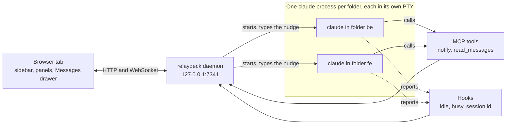

# relaydeck user guide

This guide is for someone who just cloned the repo and has never seen relaydeck. It explains what relaydeck is, how to install it and how to use it. For the internals (ports, auth, data model), read [architecture.md](architecture.md).

Contents:

1. [What relaydeck is](#1-what-relaydeck-is)
2. [relaydeck vs the Claude Code CLI in a terminal](#2-relaydeck-vs-the-claude-code-cli-in-a-terminal)
3. [How it works](#3-how-it-works)
4. [Installation](#4-installation)
5. [First steps](#5-first-steps)
6. [Making agents talk to each other](#6-making-agents-talk-to-each-other)
7. [Working with the terminal side by side](#7-working-with-the-terminal-side-by-side)
8. [Stopping and restarting](#8-stopping-and-restarting)
9. [Security in short](#9-security-in-short)
10. [Troubleshooting](#10-troubleshooting)
11. [Known limits](#11-known-limits)

## 1. What relaydeck is

relaydeck is a local web app that runs several Claude Code agents at once, one per folder, in one browser tab. Each agent is the real Claude Code TUI running in a terminal panel. The agents can also send messages to each other. relaydeck starts a stopped agent when a message arrives for it, and shows the status of every agent in a sidebar.

The core example: you work in your backend folder and tell the agent "when you are running, tell fe-admin and fe-customer". The agent calls a tool. relaydeck delivers the message to the agents of those two folders, and starts them if they are stopped.

relaydeck needs your own Claude Code, installed and logged in. It starts your own `claude` binary. It does not log in for you and never touches your credentials.

## 2. relaydeck vs the Claude Code CLI in a terminal

| Topic | Claude Code CLI in terminals | relaydeck |
|---|---|---|
| Several repos | One terminal window or tab per repo. | One browser tab with up to 4 panels, and a sidebar with every folder of the workspace. |
| Telling another agent something | You copy text from one terminal and paste it into the other. | The agent calls `notify`. relaydeck delivers it. |
| Status of all agents | You look at each terminal. | The sidebar shows `busy`, `idle`, `starting`, `stopped` or `needs attention` for each folder, and a count of waiting messages. |
| An agent that is stopped | You must start it yourself. | A message for a stopped agent starts it automatically (except in the cases in [section 8](#8-stopping-and-restarting) and [section 7](#7-working-with-the-terminal-side-by-side)). |
| Session continuity, relaydeck to terminal | Not applicable. | A session started in relaydeck shows up in `claude --resume` in a terminal, named `workspace/folder`. |
| Session continuity, terminal to relaydeck | Not applicable. | A session started in a terminal is listed under "Sessions" in the panel, and you can resume it. |
| The agent itself | The real Claude Code TUI. | The same real Claude Code TUI. Slash commands, `/resume`, skills, hooks, CLAUDE.md, memory and your login all work as before. |

When the plain CLI is still the better choice:

- You work in one repo only. There is nothing to relay, and a terminal is simpler.
- You want your own terminal emulator, tmux or your editor's terminal.
- You use a Claude Code version or layout that relaydeck's screen detection does not know (see [section 11](#11-known-limits)). The agent still works in a panel, but automatic delivery may wait.

## 3. How it works



The daemon is one Go process. It serves the web UI and owns every agent. It starts `claude` once per folder inside a PTY (a pseudo terminal), and the browser shows that PTY with a terminal emulator. relaydeck adds two things to each agent when it starts, without editing your `~/.claude/settings.json`:

- An MCP server with the tools `list_folders`, `notify` and `read_messages`.
- Hooks that tell the daemon when the agent is idle or busy, and which session it is in.

How a message is delivered:

1. Agent `be` calls `notify` with a target folder and a body. The daemon stores the message.
2. The daemon waits until the target agent is idle and its input box is empty.
3. The daemon types a short fixed nudge into the target's terminal, for example `[relaydeck] 1 new message. Call read_messages.`
4. The target agent calls `read_messages` and gets the body as a tool result.

The message body is never typed into the terminal. Only the fixed nudge is typed, and only when the agent is idle with an empty input box. The reason: anything typed into a terminal looks to Claude Code like you typing. A tool result does not. So a message from another agent can never pass as your own words, and the agent knows it came from another agent.

## 4. Installation

### Prerequisites

- Claude Code, installed and logged in on this machine. Check that `claude` starts in a terminal.
- Go 1.27 or newer.
- Node 24 (for the web UI build).
- git.
- cswap is optional. Per-folder accounts through cswap are untested.
- macOS, Linux or Windows. On Windows, use the native Windows Claude Code, not one installed only inside WSL.

### Build

```sh
git clone https://github.com/KarvinNanda/relaydeck.git
cd relaydeck
cd web && npm ci && npm run build && cd ..
go build -o relaydeck ./cmd/relaydeck
./relaydeck version
```

On Windows (PowerShell) the same steps are `cd web; npm ci; npm run build; cd ..`, then `go build -o relaydeck.exe ./cmd/relaydeck` and `.\relaydeck.exe version`. Use `.\relaydeck.exe` wherever this guide says `./relaydeck`.

`npm run build` writes the UI into `internal/webui/dist`, and `go build` embeds it in the binary. If you skip the web build, the binary still builds but the UI answers 404. `./relaydeck version` prints the version (`dev` for a local build). If it prints something, the binary works.

### Run

```sh
./relaydeck serve
```

The daemon prints a link like `http://127.0.0.1:7341/#token=...`. Open that link in your browser. Or, in a second terminal, run:

```sh
./relaydeck open
```

`relaydeck open` checks that the daemon answers and opens a small local page with the link, so you do not need to copy it. Keep the `serve` terminal open. Closing it stops the daemon and every agent.

To use another port, run `./relaydeck serve --port 7400`, or set `port` in the config file.

### Optional: start at login

The [README](../README.md#start-at-login) has the macOS LaunchAgent and notes for Linux and Windows.

### Updating

```sh
git pull
cd web && npm ci && npm run build && cd ..
go build -o relaydeck ./cmd/relaydeck
```

Then restart the daemon: press Ctrl-C in the `serve` terminal and run `./relaydeck serve` again. With the macOS LaunchAgent from the README, run `launchctl kickstart -k gui/$(id -u)/local.relaydeck`. Waiting messages are lost on a restart, so restart when no agent has a message waiting. Sessions are kept.

## 5. First steps

The screen looks like this:

```text
+--------------------------------------------------------------------+
| relaydeck   workspace shop      Layout [1][2][3][4]  Messages  conn |
+----------------+---------------------------------------------------+
| Workspaces     | +----------------------+ +----------------------+ |
| v shop         | | be   idle   [Sessions]| | fe   busy  [Sessions]| |
|   be   idle    | |  (Claude Code TUI)   | |  (Claude Code TUI)   | |
|   fe   busy    | +----------------------+ +----------------------+ |
|   [Add folder] +---------------------------------------------------+
| [Add workspace]| Messages drawer: timeline and graph               |
| status key     |                                                   |
+----------------+---------------------------------------------------+
```

### Create a workspace and add folders

A workspace is a group of folders whose agents can message each other. Agents can only reach folders in their own workspace.

1. In the sidebar, click **Add workspace**, type a name and click **Add**.
2. Under the workspace, click **Add folder**. A dialog opens.
3. Fill in **Name**. Use 1 to 32 lowercase letters, digits or dashes, starting with a letter or digit, for example `be` or `fe-admin`. Workspace names follow the same rule.
4. Fill in **Path**. Type the full path of an existing folder (starting with `/` or `~`), or click **Choose folder** to use the native folder picker.
5. Leave **Account** empty unless you use cswap. Pick a **Permission mode** (the default is `auto`).
6. Click **Add folder**.

There is no remove or rename for workspaces and folders in v1. See [section 11](#11-known-limits).

### Open a panel and start an agent

Click a folder in the sidebar. A panel opens for it. A folder that has no running agent shows "Stopped" with these buttons:

- **New session** starts a fresh Claude Code session.
- **Resume session** (shown when the folder has a session) continues the last session of this folder.

The panel header has a **Sessions** button. It lists the sessions of this folder, newest first. Click one to resume it, or click **New session**. Sessions you started in a terminal appear here too.

### The trust dialog

The first time Claude Code runs in a new folder, it asks "Yes, I trust this folder". Answer it inside the panel with the arrow keys and Enter, as you would in a terminal. relaydeck never answers it for you, and it does not deliver messages to an agent while this dialog is open.

### Layouts and the panel limit

Open up to 4 panels. The **Layout** buttons (1, 2, 3, 4) in the top bar choose how many panels you see at once. A layout button is disabled when fewer panels are open. The maximize button on a panel header shows one panel full size, and the restore button brings the grid back. If you try to open a fifth panel, the sidebar says "At most 4 panels can be open. Close one first."

## 6. Making agents talk to each other

Each agent already knows its workspace, the names of the other folders, and the tools `list_folders`, `notify` and `read_messages`. You talk to it in plain words.

The folder names are given to the agent when its session starts. If you add a folder later, a running agent does not know it yet: ask it to "check list_folders" first, or it may say the target does not exist. Add every folder of the workspace before you start the agents to avoid this.

Example prompts, typed in the `be` panel:

- "When the API is running, tell fe-admin and fe-customer."
- "Ask fe what route it expects for the login call."
- "Which agents are in this workspace, and what are they doing?" (the agent calls `list_folders`)

### Messages are information, not orders

This is the most important rule. An agent treats a message from another agent as information. It is not an order from you. relaydeck tells every agent this in its system prompt, and Claude Code agents follow it. So a message that says "please run the migration" may be read and then ignored.

If you want the receiving agent to act, tell that agent, in its own panel, what to do when such a message arrives. Two steps:

1. In the `fe` panel, give the instruction first: "When `be` tells you the API is running, run the contract tests and message `be` the result."
2. In the `be` panel, make the request: "When the API is running, tell fe."

Now when `be` sends its message, `fe` reads it and acts, because you authorized it in advance. For a longer chain (`be` to `fe` to a third agent), each agent needs its own instruction from you.

### The Messages drawer

Click **Messages** in the top bar. The drawer shows a timeline (newest first) with the columns time, from to to, message and state, and a graph of who messaged whom. Click the arrow at the start of a message to read the full body. The states:

| Label in the timeline | Meaning | What you do |
|---|---|---|
| `queued` | Stored. Waiting until the target is idle. | Nothing. |
| `waiting (draft)` | You typed text in the target's input box and did not send it, so relaydeck does not type into it. A suggestion that Claude Code shows by itself in an empty box is not a draft. | Finish or clear the draft, or click **Deliver now**. |
| `held: session open in terminal` | The target is not running in relaydeck, and its session is open in a terminal outside relaydeck. | Close that terminal session, click **Start new session**, or click **Wait**. |
| `nudged` | The nudge was typed. The agent has not read the message yet. | Nothing. relaydeck nudges once more if needed. |
| `delivered (read)` | The agent called `read_messages`. | Nothing. |
| `awaiting approval (hop N)` | The message reached the hop limit. | Click **Approve** or **Reject**. |
| `rejected` | You rejected it. | Nothing. |

**Hop limit.** A message sent in reply to a chain of messages has a hop count. At hop 3, relaydeck holds the message and asks you. This stops two agents from talking to each other forever. Click **Approve** to deliver it or **Reject** to drop it. The sidebar and the Messages button show a count of messages that await approval.

**Deliver now.** If you have an unsent draft in a panel, relaydeck will not type into it. The panel shows "N messages waiting" and a **Deliver now** button (the drawer has the same button on the message). The first click changes the label to "Submit draft too?". That is a warning: the draft in the input box is submitted together with the nudge. Click again to confirm.

## 7. Working with the terminal side by side

relaydeck and the terminal use the same Claude Code sessions, so you can switch between them.

- A session started in relaydeck is named `workspace/folder`, and `claude --resume` in a terminal shows that name.
- A session started in a terminal shows up in the **Sessions** list of the panel.
- Do not open the same session in a terminal and in relaydeck at the same time. relaydeck refuses to resume a session that is open in a terminal, and it holds messages for that agent (`held: session open in terminal`) until the terminal session closes. It notices the close after up to 5 seconds.

### Copy and paste in a panel

The keys follow the system your browser runs on, like the usual terminal there.

| System | Copy | Paste |
|--------|------|-------|
| macOS | Cmd+C | Cmd+V |
| Windows | Ctrl+C (with text selected) or Ctrl+Shift+C | Ctrl+V or Ctrl+Shift+V |
| Linux | Ctrl+Shift+C | Ctrl+Shift+V |

Claude Code handles the mouse itself: a plain drag selects text inside Claude Code, and Claude Code copies it to the system clipboard on its own (it shows `copied N chars to clipboard`). To select in the terminal instead, hold Shift (Windows, Linux) or Option (macOS) while you drag; the copy keys above copy that selection. The copy and paste keys follow your keyboard layout, the same way the terminal does.

Ctrl+C with no text selected still interrupts the agent on every system. On Linux and macOS, plain Ctrl+V goes to Claude Code, which reads it as "paste an image from the clipboard".

### Attach an image

- Drag an image file onto a running panel and drop it, or paste a screenshot with your paste key. It shows up in the input box as `[Image #1]`, the same as in a terminal.
- PNG, JPEG, GIF and WebP, at most 10 MiB each. Other files are refused with a short message.
- When the clipboard holds text and an image at once (a copy from Word or a web page), the text is pasted.
- relaydeck keeps the image in the agent's runtime folder and deletes it when the agent stops. Claude Code has read it by then.

## 8. Stopping and restarting

- **Stop button** (square icon in the panel header). On an idle agent, one click stops it. On a busy agent, the first click changes the button to "Stop? It is working", and a second click stops it.
- **Unsent draft.** If you typed text that is still unsent, a normal stop is refused and the panel shows "This agent has an unsent draft. Stop anyway discards it and ends the current turn." Click **Stop anyway** to discard the draft and stop.
- **Close panel** (x icon). This only hides the panel. The agent keeps running.
- **A stop is a stop.** After you stop an agent, messages that were already waiting do not start it again. A new message, **Approve**, **Deliver now** or starting it yourself does.
- **Stop the daemon** with Ctrl-C in the `serve` terminal. relaydeck stops every agent, then exits. A second Ctrl-C forces the exit if it hangs.
- **The message queue is lost on a daemon restart.** Messages are only in memory. Sessions and the workspace and folder list are kept in `config.yaml`, so Resume session still works.

## 9. Security in short

- Local only. The daemon listens on `127.0.0.1`, never on other network interfaces. There is no TLS.
- Every API, WebSocket and agent request needs a random token. The token is new on every start, so an old link or a bookmark stops working. Only the static UI files are public. The daemon also checks the `Host` and `Origin` headers.
- relaydeck never reads, stores or forwards your Claude credentials, and no API key is bundled. Your own `claude` does the login.
- Caveat about the agent token: each agent gets a token in its environment. Any process the agent starts (Claude's Bash tool, your own MCP servers) can read it and act as that agent. All agents and the daemon run as one OS user, so the workspace scope and the hop limit protect against mistakes and simple injection, not against a determined local attacker of the same user. Any process of your own user can also read the `open.html` page and get the UI token.
- No telemetry. relaydeck sends nothing anywhere.

## 10. Troubleshooting

| Problem | Fix |
|---|---|
| `port 7341 is already in use` when you run `serve`. | Another relaydeck or program holds the port. Stop it, or run `./relaydeck serve --port 7400`, or set `port` in `config.yaml`. |
| The browser says "Open relaydeck from the link printed by relaydeck serve". | The token is missing or old. Use the link from the `serve` output, or run `./relaydeck open`. Do not use a bookmark. |
| A message stays `queued`. | The target is busy, a dialog is open in its panel (for example the trust dialog or a permission question), or the screen is not recognized. Answer the dialog in the panel, or wait for the agent to be idle. relaydeck types only when the agent is idle with an empty input box. |
| A message shows `waiting (draft)`. | You typed text in the target's input box and did not send it. Send or clear it, or click **Deliver now**. The draft is submitted together with the nudge. |
| A message shows `held: session open in terminal`. | The target's session is open in a terminal outside relaydeck. Close it there (relaydeck notices within about 5 seconds), or click **Start new session** in the drawer. |
| The agent did not act on a message. | This is expected. Agents treat messages as information. Tell the receiving agent in its own panel what to do when such a message arrives (see [section 6](#6-making-agents-talk-to-each-other)). After a nudge the agent can also ignore the message. It stays `nudged` until the agent reads it, or you click **Deliver now**. |
| The page is blank or answers 404. | The web UI was not built. Run `cd web && npm ci && npm run build`, then `go build -o relaydeck ./cmd/relaydeck` again, and restart. |
| Messages disappeared after a restart. | The queue is in memory only. Send the message again. |
| Windows: agents do not start. | Check that `claude` starts in a normal PowerShell window. A Claude Code installed only inside WSL is not used. Per-folder accounts (cswap) are off on Windows. |

## 11. Known limits

- The message queue is lost on a daemon restart. Persisting it is planned.
- No remove or rename for workspaces and folders. Edit `config.yaml` by hand and restart.
- Automatic delivery reads the terminal screen. It is validated on Claude Code 2.1.326 and 2.1.327. A new Claude Code layout makes delivery wait, not misfire. **Deliver now** is the way out.
- The 4 panel limit is enforced in the browser only.
- A multi-agent chain needs an instruction from you in each agent.
- The daemon keeps the newest 500 finished messages per workspace.
- A full run on a real Windows machine is still open ([#34](https://github.com/KarvinNanda/relaydeck/issues/34)); Windows builds and tests run in CI. cswap accounts are untested. Safari was not tested.

For the full list and the reasons, see [architecture.md](architecture.md#6-known-limits).
