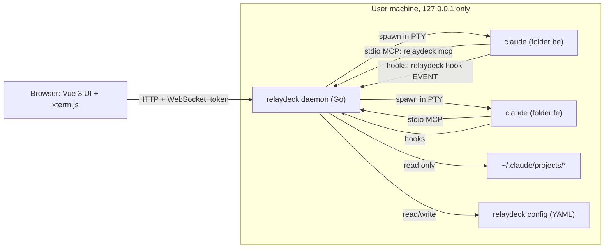

# relaydeck: design

Status: approved by Karvin, 2026-11-17
Date: 2026-11-17
Author: Karvin (decisions), Claude (write-up)

## 1. Intent

Karvin works on products split across several repos (for example 1 backend and 2 frontends, sometimes 5 to 8 connected repos). Today each repo needs its own terminal with its own Claude Code agent. Starting the system means going to the backend agent, waiting until it runs, then telling each frontend agent by hand. With 8 repos that is 8 terminals and a lot of copy-paste between agents.

relaydeck is a local web app that runs and shows many Claude Code agents at once, one per folder, and lets agents message each other. The key sentence it must support, typed into the backend agent:

> "When you are running, tell fe-admin and fe-customer."

The backend agent then calls a tool, and relaydeck delivers the message to the agents of those folders, starting them if needed.

Who it is for: Karvin first. The repo will be public on GitHub so other people can clone it and use it with their own Claude Code subscription on their own machine.

## 2. Goals

1. One web UI on localhost that shows several Claude Code agents, each in its own folder, with full CLI behaviour (slash commands, `/resume`, skills, hooks, CLAUDE.md, auto memory).
2. Session continuity with the terminal: a session started in the terminal can be resumed in relaydeck and the reverse. `/resume` must never look empty when sessions exist on disk.
3. Agent to agent messaging (`notify`) between folders, with queueing, loop protection and clear sender labelling.
4. Per-folder account selection through cswap, when cswap is installed.
5. Split view of up to 4 terminals.
6. Live status per agent (busy, idle, needs attention, stopped) and a visible log of notify messages.
7. Runs on macOS and on Windows (native). Linux is not a goal but should not be blocked on purpose.

## 3. Non-goals (v1)

- Lead agent / orchestrator agent ("approach B"). Planned for later, built on the same `notify` tools.
- A custom chat UI. The agent view is the real Claude Code TUI.
- Approving permissions from web buttons. Agents run in auto mode (see 6.4).
- A daemon-owned service manager (start/stop dev servers, ports, health checks, log panel). Later phase. In v1, agents start services themselves with their own background shell, which stays alive while the agent's `claude` process is alive.
- Claude Code running inside WSL. v1 supports Windows-native Claude Code only.
- Hosting, cloud deploy, multi-user, remote access.

## 4. Anti-goals (failure even if it "works")

- relaydeck reads, copies, stores or forwards Claude credentials or OAuth tokens. It must only ever start the user's own installed `claude` binary.
- Any route by which a web page other than the relaydeck UI, or another user on the network, can start processes or type into an agent.
- Two processes writing to the same session file at the same time.
- A separate memory or session store that drifts from `~/.claude`. Files on disk stay the single source of truth.
- Agents treating a message from another agent as if the user typed it.
- Silent account mixing: a folder mapped to account X running under account Y without the UI showing it.
- Selling or sharing accounts through this tool. The personal Pro account is not part of relaydeck at all.

## 5. Constraints

- **Policy.** Subscription login (Pro/Team) is used only through the official `claude` client. relaydeck never implements login and never handles tokens. README states: "requires Claude Code installed and logged in on this machine". No API key is ever bundled.
- **Local only.** The daemon binds to `127.0.0.1`. It is never meant to be exposed.
- **Platforms.** Developed on macOS (Apple Silicon). Windows is designed in from day one and tested by hand on Karvin's office Windows laptop after the repo is published. Until then, Windows is labelled "experimental" in the README.
- **Browser limits.** A folder dropped into a browser does not reveal its absolute path. Folders are added through a native OS folder picker opened by the daemon, or by typing a path.
- **Stack** (Karvin's defaults): Go for the daemon, Vue 3 for the UI, xterm.js for terminals. Structured JSON logs, one event per line, with `request_id`.
- **Karvin's rules apply to the repo:** PR-based work, no secrets committed, tests for every change, and an as-built `docs/architecture.md` (system diagram, auth boundary, data model, known limits) before v1 is called done.

## 6. Approaches considered

How the daemon drives Claude Code was the main decision.

| # | Approach | Trade-off | Verdict |
|---|---|---|---|
| 1 | **PTY + xterm.js + hooks.** Daemon (Go) starts interactive `claude` in a pseudo-terminal, streams it to xterm.js in the browser. Agent state comes from Claude Code hooks. Messages are typed into the PTY when the agent is idle. | Identical to the CLI for free (slash commands, `/resume` picker, skills, prompts). Uses the official client as is. UI inside the panel is a terminal, and typing into a TUI must be done carefully. | **Picked** |
| 2 | **Agent SDK (TypeScript).** Daemon in Node uses `@anthropic-ai/claude-agent-sdk` with structured messages, `canUseTool`, in-process MCP. | Exact state and free choice of chat UI, but interactive slash commands must be rebuilt, the daemon must be Node, and the SDK does not load CLAUDE.md and hooks unless `settingSources` is set (silent safety gap if forgotten). | Rejected for v1. Candidate for the later lead agent. |
| 3 | **Go + `claude -p` stream-json.** Same as 2 but speaking the stream-json protocol directly from Go. | Keeps Go, but maintains a less documented protocol and still loses interactive slash commands. | Rejected |

Karvin picked approach 1 because the main requirement is "same functionality as the CLI", which approach 1 gives without rebuilding anything.

For messaging, two shapes were considered: **A, peer messaging** (each agent has a `notify` tool) and **B, lead agent** (one workspace agent delegates to folder agents). Karvin picked **A for v1**, B later, built on the same tools.

## 7. Design

### 7.1 Components



One Go binary, `relaydeck`, with subcommands:

- `relaydeck` (or `relaydeck serve`): the daemon. Serves the embedded Vue build, the API and WebSockets.
- `relaydeck mcp`: a stdio MCP server started by each agent through `--mcp-config`. It forwards tool calls to the daemon.
- `relaydeck hook <event>`: called by Claude Code hooks. Reads the hook JSON from stdin and reports it to the daemon.

Hooks and MCP call the same binary, so nothing depends on bash or Python. This is what makes Windows support realistic.

### 7.2 Config and registry

Stored as one YAML file in the OS user config dir (`os.UserConfigDir()`: `~/Library/Application Support/relaydeck/config.yaml` on macOS, `%AppData%\relaydeck\config.yaml` on Windows). Human-editable.

- **Workspace:** a named group of folders, for example `game-lounge`.
- **Folder entry:** short name (unique inside the workspace, used as the `notify` target), canonical absolute path, optional cswap account, optional "current session id".
- Runtime state (status, queues, PTYs) lives in memory only.

Path rule: every path is stored in **canonical form**: absolute, symlinks resolved, and on case-insensitive file systems in the on-disk letter case. Reason: Karvin's folder `/Users/karvin/kv/relaydeck` is on disk as `/Users/karvin/KV/relaydeck`, and Claude Code keys sessions by the cwd string (`~/.claude/projects/-Users-karvin-KV-...`). A case mismatch could make `/resume` look empty. How Claude Code itself derives that string must be confirmed in the spike (section 9).

### 7.3 Starting an agent

For a folder, the daemon starts, inside a PTY, with cwd = the canonical path:

```
claude <FLAGS>                                     (no account set)
cswap run <account> [cswap options] -- <FLAGS>     (account set: cswap starts claude itself,
                                                    args after "--" go to claude)

FLAGS:
    --permission-mode <mode, default "auto">
    --mcp-config <generated json pointing at "relaydeck mcp">
    --settings <generated json with relaydeck hooks>
    --append-system-prompt <relaydeck instructions: what notify is, which folder names exist>
    (--resume <session-id> | --session-id <new uuid>)
    --name <workspace/folder>
```

Environment added to the child: `RELAYDECK_URL`, `RELAYDECK_AGENT_ID`, `RELAYDECK_AGENT_TOKEN`. Hooks and the MCP subprocess inherit them, which is how they authenticate to the daemon and say which agent they belong to. The agent token is created per agent and only works on the hook and MCP endpoints, for that agent only. The UI token is never put in an agent's environment (see 7.9).

Rules:

- Same user, same HOME, same `~/.claude`: sessions, CLAUDE.md, auto memory, skills and the user's own hooks load exactly as in the terminal. relaydeck never edits the user's `~/.claude/settings.json`. Its hooks are passed per process through `--settings`.
- The daemon assigns the session id up front for new sessions (`--session-id`), so it always knows which session file belongs to which panel.
- Session picker in the UI: lists `~/.claude/projects/<encoded cwd>/*.jsonl` for that folder (read-only metadata: id, time, first prompt or name). Picking one starts the agent with `--resume`.
- Permission mode is a per-folder setting with default `auto`, because that is how Karvin uses the CLI.

### 7.4 Agent status

Status comes from hooks (`relaydeck hook <event>`):

| Hook event | Status |
|---|---|
| SessionStart | idle |
| UserPromptSubmit | busy |
| Stop | idle |
| Notification | needs attention (auto mode blocked something, or the agent asks the user) |
| SessionEnd / PTY exit | stopped |

The UI shows status as a badge per folder and per panel.

### 7.5 notify (peer messaging)

MCP tools exposed to every agent:

- `list_folders()`: folders in the same workspace, with status.
- `notify(target, message)`: send a message to another folder in the same workspace.
- `read_messages()`: return and mark as read the messages waiting for the calling agent.

Delivery is a **pull model** (Claude's call, after the builder check): the message body never goes into the PTY as typed text. Reason: anything typed into the PTY is a user turn, and auto mode treats user turns as user intent. A tool result is treated as data. So the "not from the user" rule is enforced by the channel, not only by the wording.

1. Validate the target is in the same workspace. Unknown target returns an error listing valid names.
2. Store the message for the target with sender, time and hop count.
3. Wait until the target is idle. Never interrupt a busy agent.
4. If the target has no running agent, start one (resume its current session, or new session if none).
5. If the target's session is currently open in an external terminal (see 7.6), hold the message and show it in the UI as "held, session open in terminal". The user can release it into a new session or wait.
6. Hold while the user has an unsent draft in that panel. The daemon proxies all PTY input, so it tracks "typed since last Enter". The UI shows "1 message waiting" on the panel. Delivery happens once the draft is sent or cleared.
7. Type a short fixed nudge into the PTY (bracketed paste, then Enter), for example: `[relaydeck] You have 1 message from agent "be". Call read_messages.` The body arrives as the `read_messages` tool result, with the sender and "not from the user" in it.
8. Hop limit: a message sent by an agent while it handles a delivered message carries hop+1. At hop 3, the daemon stops and asks the user in the UI before delivering.

The receiving agent then acts within its permission mode (auto by default), so the core use case ("start your dev server, then tell fe") needs no human step.

Every notify appears in a timeline in the UI (time, from, to, message, delivered/held/blocked).

### 7.6 Detecting a session open in an external terminal

Decision (Karvin, option a): before relaydeck resumes a session, check whether a `claude` process outside relaydeck is running with the same cwd. If yes, do not resume. Hold and tell the user.

- macOS: list processes named `claude` and read their cwd.
- Windows: reading another process's cwd is harder. Approach to be chosen in the spike (process API, or `claude agents` output if it lists interactive sessions, or a lock written by a SessionStart hook in the user's settings as an opt-in fallback).

### 7.7 Accounts (cswap)

Background: `cswap run` keeps sessions and auto memory per account by default (section 9, item 7). Karvin switches accounts today through the cswap TUI (`cswap tui`, aliased as `watchclaude`), which changes the global default login, so his existing sessions live in `~/.claude`.

Decision (Karvin): **use `--share-history`**, so every account sees one history in `~/.claude` and Goal 2 holds.

- **macOS:** if `cswap` is on PATH and a folder has an account, the agent starts as `cswap run <account> --share-history -- <FLAGS>`. Without an account, plain `claude <FLAGS>` under the default login.
- **Windows:** `--share-history` is not supported, so per-folder accounts are disabled on Windows in v1. All agents run under the default login. The account field is hidden there.
- **Where the account is stored** (Claude's call): in relaydeck's own config, per folder. When a folder is added, the field is prefilled from `cswap map` if a mapping exists. relaydeck passes the account explicitly, so it never depends on cswap's mapping at runtime.
- **Default login case** (Claude's call): when the folder's account is also the current default login, cswap runs plain `claude`, and a later switch in the cswap TUI would move that agent to another account. relaydeck does not pass `--require-session` (it would refuse to start). Instead it reads `cswap status` on start and periodically, shows each agent's account, and marks agents "on default login, a switch will move it" so the mix is never silent.
- relaydeck never calls cswap commands that change global state (`switch`, `add`, `remove`, `map`) in v1.

### 7.8 UI

- **Sidebar:** workspaces, their folders, status badge per folder, add folder (native picker or typed path), add workspace.
- **Main area:** 1 to 4 terminal panels. Layouts: 1 full; 2 side by side; 3 = left full height plus right split in two; 4 = 2x2 grid. Max 4. Resizing a panel resizes the PTY.
- **Notify view:** small graph of the workspace's folders with arrows that light up on each notify, plus the timeline from 7.5.
- **Session picker** per folder.
- The visual design is chosen from static HTML mockups before any UI code is written.

### 7.9 Security model

- Daemon listens on `127.0.0.1` only, on a fixed default port that can be changed.
- On each start the daemon creates a random token (at least 128 bits). The UI URL printed in the terminal carries it once, and the UI keeps it in memory or session storage. Every HTTP and WebSocket request must carry it.
- Every request checks `Host` (must be `127.0.0.1:<port>` or `localhost:<port>`) to block DNS rebinding, and `Origin` on WebSocket upgrades and state-changing requests to block cross-site requests.
- Hooks and MCP subprocesses authenticate with a per-agent token from their environment. It only allows that agent's hook reports and MCP tools (`list_folders`, `notify`, `read_messages`). It cannot type into PTYs, start agents directly, or read other panels. Reason: an agent, or a prompt injection it reads, could otherwise use the token to bypass the workspace scope and the hop limit.
- No credentials, tokens or session contents are sent anywhere. No telemetry.
- Path inputs are canonicalised and must point to an existing directory.

### 7.10 Platform notes

| Concern | macOS | Windows |
|---|---|---|
| PTY | Unix pty | ConPTY. Need a Go library that supports both (candidate: `github.com/aymanbagabas/go-pty`). |
| Folder picker | native dialog | native dialog (candidate: `github.com/ncruces/zenity` covers both) |
| External session detection | process cwd | see 7.6 |
| cswap | installed (Python tool via uv), used with `--share-history` | per-folder accounts disabled in v1 (`--share-history` unsupported) |
| Session dir encoding | `-Users-name-...` | to confirm in spike (drive letter, backslashes) |

Distribution: one binary per OS with the Vue build embedded (`embed`), released through GitHub Releases later.

## 8. Done criteria for v1

- All goals in section 2 work on macOS, shown running, with automated tests for config, path canonicalisation, notify queue, hop limit, envelope, token/Host/Origin checks.
- Windows builds in CI. Manual Windows test is a separate tracked task, done on the office laptop.
- README with install, requirements and the policy note from section 5.
- As-built `docs/architecture.md` (system diagram with ports, auth boundary with sequence diagram, data model, rules not enforced by the schema, known limits, where to change things), with every Mermaid block checked by a parser.

## 9. Spike before planning in detail

These facts are assumed above and must be confirmed with small throwaway tests before the build plan relies on them:

1. Interactive `claude` runs correctly inside a Go PTY on macOS, and resizing works. Library choice for Windows ConPTY.
2. `--settings <file>` adds relaydeck hooks **without** disabling the user's own hooks (for example `block-main.py`). If it replaces them instead, stop and bring it back to Karvin before choosing a fallback (the only other per-folder place is the repo's `.claude/settings.local.json`, which writes into the user's repos).
3. The hook events in 7.4 exist in Claude Code 2.1.x with the meaning assumed, and hook processes inherit the child environment.
4. How Claude Code turns the cwd into the `~/.claude/projects` folder name, including letter case on macOS and drive letters on Windows.
5. Bracketed paste plus Enter into the Claude Code TUI delivers a multi-line message as one prompt.
6. Detecting an external `claude` session for a folder (macOS process cwd; whether `claude agents` lists interactive sessions).
7. (Answered during the builder check, see 7.7.) `cswap run` uses a per-account session profile: `projects/` and `history.jsonl` are per account unless `--share-history` is passed, and that flag is not supported on Windows. Still to confirm: what `--share-history` does to an existing profile on first use (it merges the profile's history into `~/.claude`). Before the first run, list the size of each cswap profile's `projects/` (read-only) so the merge is not a surprise.
8. What auto mode does in practice when it blocks an action (does it fire `Notification`, does the agent stop and wait).

## 10. Left to the builder

- Go and Vue project layout, HTTP router, WebSocket library, test framework.
- Exact API routes and WebSocket message shapes.
- Default port number.
- Config file schema details beyond 7.2.
- Exact wording of `--append-system-prompt` text and of the notify envelope, as long as it states the sender and "not from the user".

## 11. Later (not v1)

- Lead agent (approach B) using the same `list_folders` / `notify` tools.
- Daemon-owned services panel (start/stop dev servers, ports, health checks, logs).
- Approve permissions from the web UI.
- WSL support on Windows.
